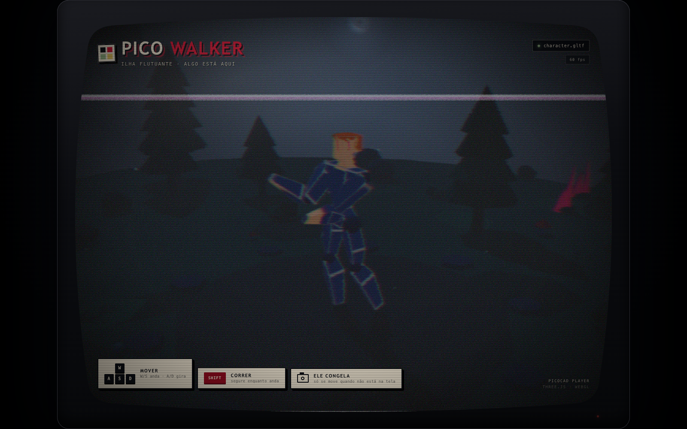
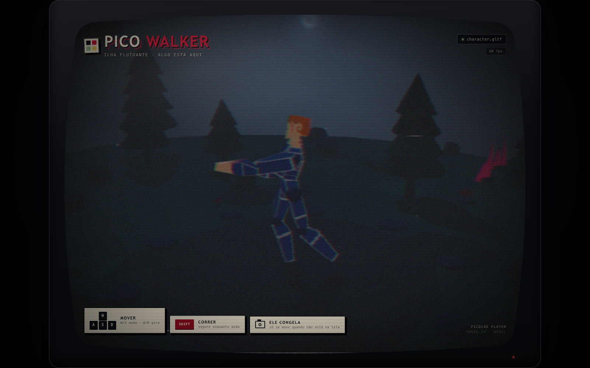
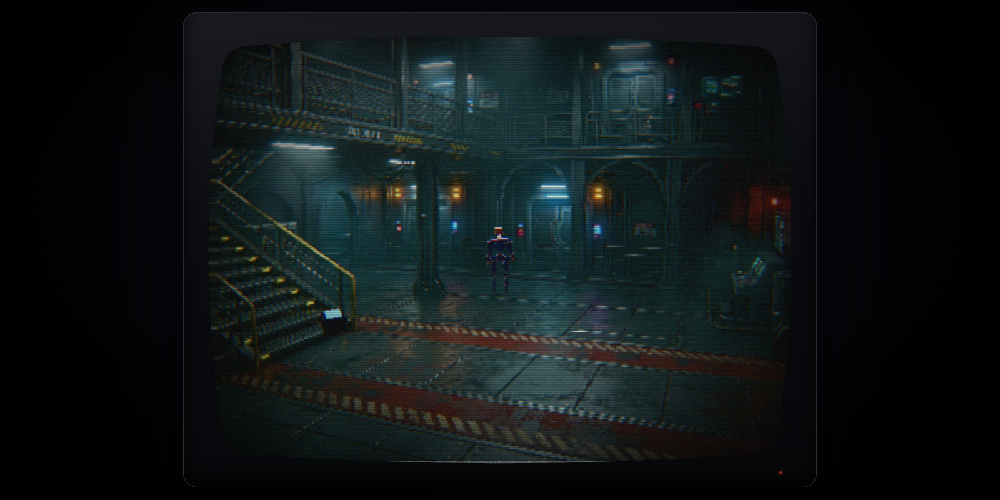
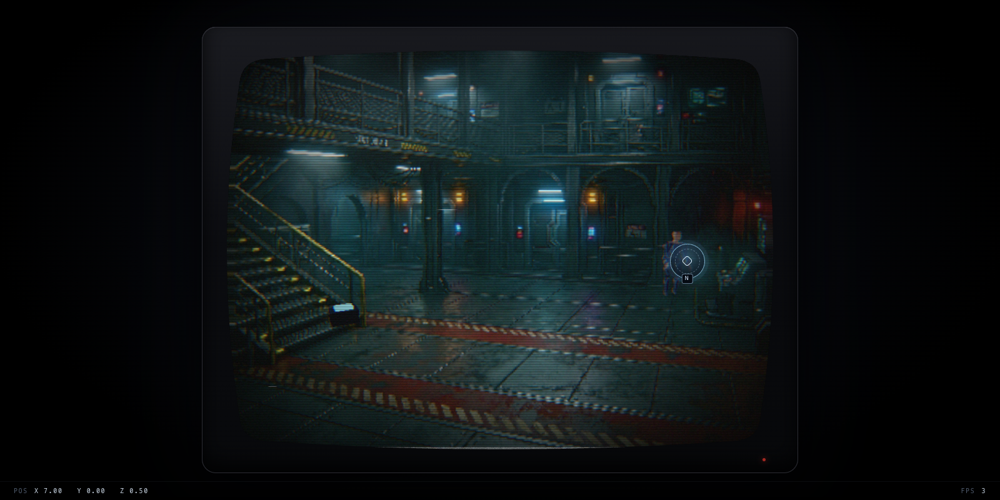
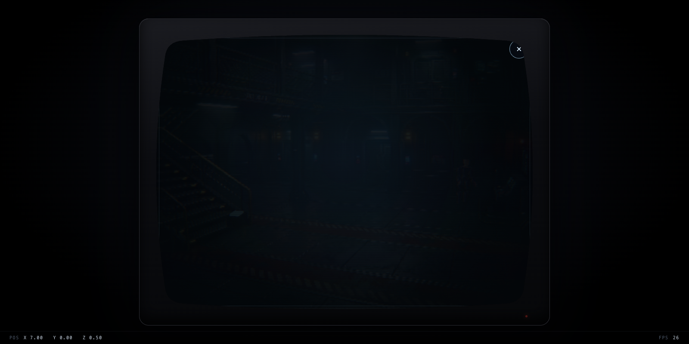
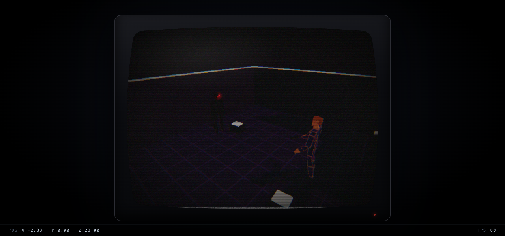
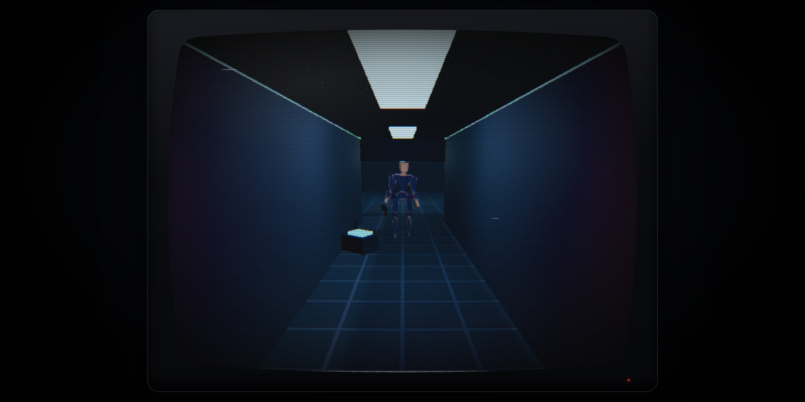
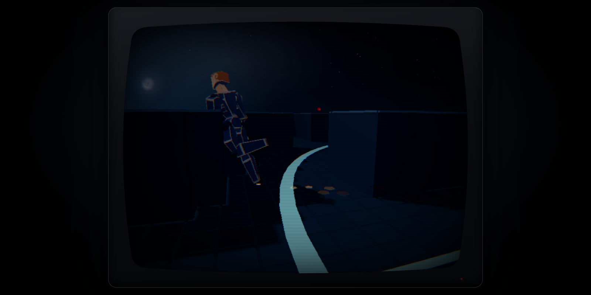
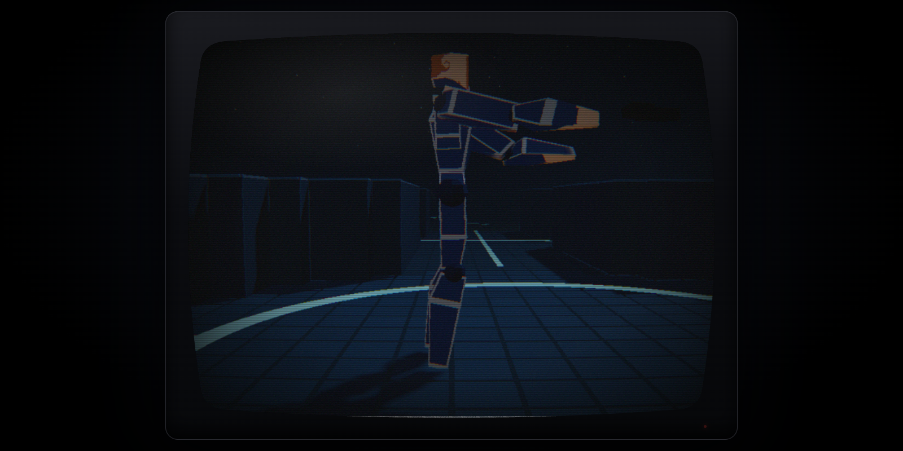

# PICO WALKER

Jogo 3D low-poly no navegador com o personagem do picoCAD (`Entities/Player`) preso em uma
estação orbital. O controle é de tanque (**W/S** anda, **A/D** gira) com **câmeras fixas** que
cortam de um enquadramento para outro conforme o personagem entra em cada zona da planta. À
noite, e não sozinho.



Um strike comprometido, com tronco e ombro:



## A estação

O primeiro deck é feito à mão: um **salão** de 16×14, um **corredor** de 4,2×14 e uma **sala**
de 12×10, ligados por dois vãos com porta. A saída do salão fica na **parede sul**, deslocada
à esquerda (x −4,44..−0,22); o corredor e a sala seguem para o sul. A construção é da classe
`StationBuilder`
(`src/world/stationBuilder.js`), que encadeia etapas:

```js
const room = new StationBuilder()
  .buildFloor()
  .buildWalls()
  .buildDoor()
  .buildLighting()
  .getResult();
```

`buildFloor` cria três lajes com painéis; `buildWalls` levanta 12 segmentos a partir das
corridas de parede em `src/world/layout.js`; `buildDoor` monta batentes, cabeceira e a
comporta elevada; `buildLighting` acende painéis e point lights. O builder publica
`wallBoxes` para a navegação e não conhece player, inimigo nem câmeras.

`src/world/station.js` liga o builder ao plano (`createPlanFromAreas`), que pinta as áreas
numa grade de 1 unidade, e à navegação (`createNavigation`), que recebe o plano + os boxes e
expõe colisão círculo-vs-AABB (`station.resolve`), BFS (`station.findPath`) e linha de visão
(`station.blocked`). `buildWorld` só compõe ambiente + estação.

O **salão** usa uma imagem pré-renderizada, `assets/Scenario/Hall.png`, no estilo dos
adventures de 1996: quando a câmera do salão está no ar, o grupo 3D da estação é escondido, o
plano é pintado pela imagem (`src/world/backdrop.js`, com `cover` para não encaixotar o tubo)
e o player + inimigo continuam em 3D por cima, com uma sombra de contato para não flutuarem.
O corredor e a sala seguem 3D.



## Leitura de debug

A faixa inferior, fora do tubo, mostra **`POS X Y Z`** (posição do player em unidades de
mundo) e **`FPS`** (taxa medida pelo loop). Serve para acompanhar a construção: dá para ler
onde o player está e como o frame responde sem colocar HUD sobre a imagem.

As três **áreas** têm uma camada de piso no debug: azul no salão, verde no corredor e lilás
na sala, com contorno e etiqueta de dimensões + células andáveis do plano (224 / 56 / 120).
O preenchimento respeita a profundidade (o player fica por cima); o contorno é x-ray.

### Editor de gizmos

Com a faixa de debug visível, o painel **gizmos** na borda direita mostra o JSON das três
áreas. Arraste as bolinhas dos cantos no piso para ajustar a área; **cada canto se move
sozinho** (a área vira um quadrilátero livre) e fill, contorno, etiqueta e handles acompanham
em tempo real. **copiar JSON** manda o resultado para a área de transferência; **salvar**
guarda no `localStorage`; **resetar** volta ao layout.

O painel **rig** na borda esquerda (dev) expõe as juntas do player em graus:
tronco, cabeça, braço/cotovelo da pistola, braço/cotovelo de apoio, pernas/joelhos e
quadril. Marque **posar manualmente** para a animação parar de sobrescrever a pose;
**copiar JSON** leva os valores para a área de transferência. **resetar** volta à pose
capturada quando o painel abriu.

O **mapa em planta** no painel mostra a estação inteira, inclusive o que fica fora do
enquadramento da câmera de gameplay. Arraste os cantos ali para alcançar qualquer um dos 12
handles; o ponto branco é o player e os pontos âmbar são as portas.

O editor mexe **só nos dados de edição/gizmos**: o jogo, a navegação e as câmeras continuam
usando `layout.js` até o JSON ser aplicado no código. O JSON tem o formato:

```json
{
  "hall": {
    "corners": [[-8, -7], [8, -7], [8, 7], [-8, 7]]
  },
  "corridor": {
    "corners": [[-4.44, 7], [-0.22, 7], [-0.22, 21], [-4.44, 21]]
  },
  "room": {
    "corners": [[-8.33, 21], [3.67, 21], [3.67, 31], [-8.33, 31]]
  }
}
```

As portas têm **gizmos** de debug no mundo (visíveis enquanto a faixa de debug está visível;
`G` alterna): caixa ciano do vão, anel ciano do raio de interação (2,6), anel âmbar do
histerese (3,1), marcadores verdes/rosas dos pontos de pouso com a seta da direção e uma
etiqueta com as áreas ligadas.


## O inimigo

`createEnemy()` em `src/entities/enemy.js`: **uma cópia preta do próprio player**. `Player.createShadow()`
clona o holder com o rig inteiro e troca todo material por preto (`0x05060a`), então a coisa
tem o mesmo corpo, a mesma escala e a mesma caminhada que você — só que animada por fase, sem
input. Os dois olhos vermelhos ficam no topo da cabeça, medidos pelo bounding box do pivô.

Ela nasce no ponto mais distante da estação depois de ~7 s e caminha **célula a célula pelo
BFS** até você — nunca atravessa parede, e só pega quando está perto e sem parede no meio
(`navigation.blocked`). A entidade recebe só a API de navegação e o corpo; não conhece a
planta nem os meshes da estação. O congelamento usa a projeção real na tela: para no centro do
enquadramento e volta a andar quando escorrega para a borda. A velocidade cresce com a noite
(1.55 → 5.2), sempre abaixo da corrida (7.6), então `Shift` compra distância, mas a estação tem
módulos e portas. Encostou: corte seco para preto e respawn no núcleo.

O medo é lido em três camadas: o vermelho sangrando nas bordas (`--fear`), a câmera fechando o
FOV de 46° para 40° e tremendo, e o corpo do personagem tremendo por cima da animação.

## Interface de proximidade

Na parede leste do salão, em **x 7,46 / z 0,50**, há um ponto de interação. Aproximar-se
(≤ 2,6) faz surgir um **ícone redondo** ancorado no mundo, com a tecla `N`; afastar-se
(> 3,1) o esconde.

Com a pistola baixa, `N` (ou `RT`/`A` no controle) ou um clique no ícone abre a **tela de
interface** — por enquanto
vazia, só com o botão redondo de fechar. A tela **pausa o jogo**: o tempo de jogo congela
(player, inimigo, câmera e tiro), mas o CRT e o contador de FPS continuam. Fechar pelo botão
ou por `Esc` retoma de onde parou; teclas seguradas (andar) continuam valendo.

As **duas portas** (salão→corredor em z=7 e corredor→sala em z=21) usam o mesmo prompt:
sem mirar, `N`/`RT` fecha a porta, mostra o `Loading`, coloca o player do outro lado, faz o
corte de câmera e reabre a porta. O console do salão continua abrindo a interface.

Com a pistola erguida (`M`), `N` continua atirando; para interagir, solte a mira. O ícone é
um botão redondo em CSS — o conteúdo pode ser trocado por uma imagem sem mexer na interação.





## Atmosfera hostil

Quando o inimigo está na **mesma área** do player (salão, corredor ou sala), a tela recebe um
**multiply vermelho** no shader do CRT (`uHostile`), com fade suavizado no `main.js`. A regra
só vale depois que ele acordou (`enemy.group.visible`); no começo, com o inimigo ainda
escondido, não há vermelho.

O corte é `SAFE_ROOMS`, em `src/main.js`: **1** = só a mesma área acende (qualquer outra é
segura); **2** = o vermelho continua com o inimigo a uma área de distância. O corredor conta
como área. O filtro é **chapado**, sem gradiente: `vec3(1.0, 0.4, 0.34)` multiplica a tela
inteira em `src/crt.js`; `uHostile` só faz o fade. Para mais ou menos vermelho, mexa nesses
três números.



## Performance

Medição em headless a 1280×800, forçando frames (os números são desta máquina, não uma
garantia): salão **~43 fps**, sala 3D **~35**, a mesma sala com o compositor do CRT desligado
**~44**. O compositor do CRT é o maior custo isolado; a sala 3D fica ~8 fps abaixo do salão
(que usa a imagem pré-renderizada e esconde a estação). O blend CSS antigo da atmosfera, as
camadas de grão, as sombras e o alvo byte não mostraram ganho no headless.

O que mudou para segurar as quedas:

- o vermelho saiu do `mix-blend-mode` de tela cheia e foi para o shader do CRT (um blend de
  compositor a menos, que é caro em tela retina);
- a qualidade adaptativa agora pula direto para o modo sem CRT quando mede **< 32 fps por
  duas janelas (1 s)**, em vez de gastar ~4,5 s descendo um nível por vez;
- sombras: `PCFShadowMap` (não mais soft), mapa 768² e atualização a **20 Hz**.

`C` continua ligando/desligando o CRT na mão. A qualidade adaptativa nunca volta sozinha; se
o modo flat entrar, `C` devolve o tubo.

## As câmeras

A câmera é dividida em **estratégias** (`src/camera/`) e um **manager**. A estratégia só
calcula uma pose (posição, quaternion, fov); o manager escolhe qual está ativa, aplica a pose
e faz a transição.

- `CameraStrategy` — o contrato base.
- `FixedCamera` — os 5 enquadramentos clássicos com zonas, histerese e corte seco; as setas
  alternam os shots do grupo atual.
- `RoomCamera` — uma câmera por sala (salão e sala).
- `CombatCamera` — ombro direito, lente 55 (só no ciclo manual com `V`; mirar não troca mais a câmera).
- `FollowCamera` — segue o corpo; é o fallback e um modo manual.
- `CameraManager` — política automática e transição: blend de 0,24 s quando a área não muda;
  corte seco na troca de área e nas trocas internas de shot da fixa.

Política automática: **mirando → Combat**; **salão/sala → Room**; **corredor → Fixed**; **fora
das áreas → Follow**. `V` cicla auto → fixed → room → combat → follow.

O salão continua pré-renderizado: o backdrop é ativado pela área do player (`station.areaAt`),
não pela estratégia, então mirar no salão mantém a imagem e só aproxima o enquadramento.

Os ângulos 3D foram escolhidos para o player sempre aparecer: `CameraManager.validate()`
amostra as células andáveis de cada zona e confere, com `station.blocked3D`, se nenhuma
parede fica entre a lente e o chão. As quatro câmeras 3D enxergam pelo menos **80%** da
própria zona; o salão é um backdrop e não depende de paredes.



## A pistola

Mira no teclado: segurar **M** ergue a pistola e entra em **aim-walk** (~30% da
velocidade, giro mais lento), com as pernas continuando a caminhada; o corpo não congela mais.

O passo usa **IK de duas pernas com alvo de pé** (adaptado do `animation_config.json` do
unnamed_horror): o pé de apoio fica no chão, o de balanço levanta, e a cadência vem da
velocidade para o pé não patinar.
devagar com **A/D**; **N** atira na direção em que o personagem aponta. O pente tem 8
balas e a reserva começa em 16 — recarregar é **R** e leva 1,5 s. Quatro caixas de munição
(uma no salão, uma no corredor e duas na sala, +8 cada) são a única fonte de balas.

O tiro acerta a criatura se ela estiver na linha, sem parede no meio (`station.rayHit`);
ela **não morre**: leva um empurrão, fica atordoada por 3,2 s, tomba de lado e volta. É
tempo, não solução. Sem HUD, o estado da arma é diegético: o estalo seco quando o pente
esvazia, os dois cliques da recarga e o recuo da câmera.

Som, tiro e munição são sintetizados em WebAudio (`src/game/audio.js`), sem arquivos. A
arma é uma máquina de estados pura (`src/game/weapon.js`) coberta por `npm test`.


## O tubo

O jogo não é uma janela, é um sinal de TV. A imagem é renderizada a **720×540** — resolução
de transmissão, não de retina — e passada por um `ShaderPass` que faz o warp de tubo, o
deslize de sincronismo (bandas horizontais escorregando por um frame) e a separação RGB que
cresce nas bordas. Depois ela é ampliada para dentro de um `clip-path` de tubo 4:3, com
moldura de plástico, sombra interna e LED de standby.

Por cima, tudo em CSS: scanlines, grão de fita, croma, dropouts, a faixa de tracking que sobe
a cada ~10 s e o ruído de head-switching no pé da imagem. Nada disso depende da resolução,
então custa quase nada.

`C` desliga o warp e o composer inteiro (volta a renderizar direto no canvas), mantendo
scanlines e fita: saída de emergência para máquinas lentas.

## Rodar

Requisitos: Node.js 20+.

```bash
pnpm install
pnpm dev
```

Abra **http://127.0.0.1:4180**.

O servidor é um arquivo estático próprio (`server.mjs`), sem etapa de build: o navegador
carrega os módulos direto de `node_modules/three` via **import map**.

## Publicar no itch.io

O jogo não tem build de runtime: o itch recebe um ZIP estático com `index.html` na raiz.

```bash
npm run build:itch
```

Gera:

- `dist/itch/` — árvore pronta para servir em qualquer subpasta;
- `dist/pico-walker-itch.zip` — arquivo de upload (~0,5 MB, ~50 arquivos).

O `tools/build-itch.mjs` copia `src/`, `assets/`, `styles.css` e o `index.html`, aponta o
import map para `./vendor/three/...` (`three.module.min.js` + `three.core.min.js` + os 10
addons usados), copia a licença MIT do three e esconde a faixa de debug `POS/FPS` da build.
O `index.html` da raiz continua usando `node_modules` no `npm run dev`; os caminhos de
runtime de assets já são relativos.

No itch: **Create new project → HTML**, suba o ZIP, marque **This file will be played in
the browser** e use o botão de tela cheia. O jogo é 4:3, teclado + gamepad (não é mobile);
sugestão de embed 1280×720. O ZIP não inclui `server.mjs`, `node_modules`, testes, README
nem os previews. As imagens `preview-*.png` servem de screenshots; o cover do itch é
630×500 (recorte de uma delas). O `LICENSE` do three.js vai em `vendor/three/LICENSE`;
credite o three.js na página.

Observação: a build usa o `assets/Scenario/Hall.png` **como está no repositório** — hoje
ele é um line-art cinza (o preview colorido em `preview-station.png` é de uma versão
anterior). Para publicar com a arte colorida, troque o arquivo e rode `npm run build:itch`
de novo.

Para testar como o itch serve (subpasta): `npm run dev` e abra
`http://127.0.0.1:4180/dist/itch/`. Para manter o POS/FPS na build, mude `HIDE_DEBUG`
para `false` em `tools/build-itch.mjs`.

## Controles

| Tecla | Ação |
| --- | --- |
| `W` | andar para frente |
| `S` | recuar devagar (backpedal) |
| `A` | girar o corpo para a esquerda |
| `D` | girar o corpo para a direita |
| `←` / `→` (ou `↑` / `↓`) | alternar entre os ângulos fixos da área |
| `V` | alternar a estratégia de câmera (auto/fixa/sala/combate/segue) |
| `Esc` | fechar a interface (quando aberta) |
| `Shift` | correr |
| `M` | erguer a pistola (segurar para mirar) |
| `N` | atirar; sem mirar, perto do painel abre a interface e perto de uma porta faz a transição |
| `R` | recarregar |
| `C` | ligar/desligar o warp do tubo |
| `G` | mostrar/ocultar os gizmos das portas (debug) |

### Gamepad

Mapeamento padrão (Xbox / PlayStation / a maioria dos controles USB):

| Controle | Ação |
| --- | --- |
| Stick esquerdo / D-pad | andar (Y) e girar (X); o stick é analógico |
| LT | mirar (segurar) |
| RT / A | atirar; perto do painel do salão e sem mirar, abre a interface |
| X | recarregar |
| LB / RB | ângulo fixo anterior / próximo |
| Y | trocar a estratégia de câmera |
| L3 / R3 | correr (segurar) |
| B / Start | fechar a interface |

O `Input` sonda o controle a cada frame; apoie o controle e aperte um botão com a página em
foco para o navegador expô-lo. O mapeamento é o `standard` do Gamepad API; se o seu controle
não for padrão, os índices ficam em `src/gamepad.js`.

O movimento é relativo ao corpo do personagem, não à câmera: como os enquadramentos mudam,
`W` continua sempre sendo "para onde o corpo aponta". As setas não giram a câmera — elas
trocam para outro ângulo fixo da área atual (o salão tem um, o corredor dois, a sala dois).
Giro e velocidade usam
inércia: o personagem responde rápido ao começo do comando, mantém massa no deslocamento
e freia sem deslizar demais. A animação procedural mistura passada, recuo, giro parado e
idle.

A pistola é a única arma, e o combate é escasso de propósito: 8 balas no pente e 16 na
reserva, com quatro caixas espalhadas pela estação. A camada de pose (`src/combat.js`)
continua disponível para guarda e impacto, e pode ser acionada pela API abaixo.

## O player

- Origem: `Entities/Player/character.gltf` (+ `.bin` e `.png`), exportado do picoCAD 2.
- Cópia usada pela web: `assets/player/` (o original foi mantido intacto).
- O glTF chega com 14 malhas separadas (cabeça, tronco, braços, pernas…), sem hierarquia.
  Em `src/entities/player.js`, essas malhas são reorganizadas em pivôs de pelve, cintura, cabeça,
  ombro, cotovelo, quadril e joelho. Pequenas juntas esféricas em navy cobrem os vãos
  entre as peças e dão a leitura de articulações.
- A postura parada é assimétrica e tensa: peso em uma perna, joelhos macios, guarda baixa,
  respiração em duas frequências e uma cabeça que muda de foco em intervalos irregulares
  (`glanceTimer`), em vez de olhar em círculos.
- O modelo tem **2,65 unidades** de altura (metade da escala anterior), proporcional às
  paredes de 3,6. A colisão (`radius 0.36`), o alcance da captura (`0,95`), a altura do
  laser (`1,2`) e os olhos/sombra do inimigo acompanham a escala.
- A caminhada tem pulsos de contato (`gaussian` na fase do passo) que afundam o corpo e
  jogam ombros/cabeça, com braços contidos e cotovelos flexionados. A corrida projeta o
  corpo inteiro à frente (inclinação compartilhada entre visual, cintura e pelve), afunda
  os joelhos, alonga a passada, fecha os braços e faz os ombros acompanharem; a postura
  entra com inércia (`runBlend`) em vez de saltar ao apertar Shift.
- Soltar o movimento no meio de uma corrida deixa peso para frente (`stopInertia`): o corpo
  afunda, os joelhos absorvem e a postura se acomoda em vez de congelar ereta.
- Com a pistola fora e sem mirar, o corpo fica em **low-ready de uma mão**: a mão da arma
segura a pistola baixa no quadril e o braço livre continua o balanço natural da caminhada.
As duas mãos só se encontram na mira. (Referência: cv-remake / RE clássico; ver
`docs` abaixo.)

A mira é uma camada em quatro estágios (`aimSettle`, `aimBlend`, `aimSupport`,
  `aimBrace`): ombros e tronco se ajustam primeiro, o braço dominante sobe, a mão
  secundária cruza para apoiar a pistola e só então os joelhos flexionam. Cada estágio tem
  velocidade própria; na saída, a mão de apoio solta antes do braço descer.
- O recuo do disparo vem do evento real: `shooting.js` chama `player.applyRecoil()` no
  momento em que o tiro sai, e a camada resolve o impulso (braço, ombro, tronco, cabeça,
  joelhos e peso) com ataque rápido e recuperação exponencial — tiros seguidos se conectam
  sem voltar à pose inicial.
- A camada de combate continua por cima: guarda e ataque usam alvos absolutos de tronco e
  braços, enquanto as pernas mantêm o ciclo com offsets aditivos. A ordem é fixa:
  locomoção → guarda → mira → ataque → dano → medo. O dano interrompe a mira; o tremor de
  medo soma por cima sem quebrar a postura.



- A textura usa o atlas 128×128 do picoCAD com filtro `NearestFilter` para preservar o
  visual pixelado. O material recebe um leve `emissiveMap` para o personagem continuar
  legível contra a luz fria da lua.


## Camada de combate

`src/combat.js` concentra o estado de combate e os alvos de pose; `Player` só mistura o
resultado na pose procedural. Não há armas, dano, colisão de ataque ou teclas de combate
ainda — de propósito.

```js
pico.combat.ready(true);              // entra na guarda bladed
pico.combat.attack("right");          // cruzado direito (ou "left")
pico.combat.hit(0.8, Math.PI / 2);    // flinch vindo da direita, sem mudar posição/facing
pico.combat.reset();
```

- **Guarda**: postura baixa, pés em linha, ombros à frente e mãos entre o corpo e a ameaça.
- **Ataque**: keyframes com antecipação (carrega o tronco), impacto curto e acelerado e
  recuperação mais longa. O ombro e o quadril giram; a cabeça acompanha o alvo. O peso vai
  à frente no impacto (`lunge` no visual, root intacto).
- **Hit**: resposta de mola amortecida (sem loop senoidal). As mãos sobem para proteger a
  cabeça, os joelhos cedem e o tronco volta; a duração é dada pela própria mola.
- **Sobreposição**: um ataque pode começar andando. O controle de velocidade cai para ~60%
  durante o comprometimento, o root continua sendo movido/orientado pelo jogador e um
  hit cancela o ataque. Um segundo ataque durante a fase comprometida retorna `false`;
  depois do follow-through ele pode encadear.
- **API de debug**: `window.pico.combat` é um alias de `window.__pico.combat` (ver
  `src/main.js`). O estado também aparece em `window.__pico.state.combat`.

## Estrutura

```
index.html          loader, faixa de debug (pos/fps), prompt/menu da UI, clip-path e import map
styles.css          tubo, moldura, scanlines, grão, tracking e --fear
server.mjs          servidor estático local (porta 4180)
src/main.js         renderer, loop, medo, captura/respawn e API de debug
src/crt.js          composer, warp de tubo, sincronismo e separação RGB
src/input.js        teclado + gamepad, uma superfície de intenção
src/gamepad.js      mapeamento do controle (standard)
tools/build-itch.mjs build estático + ZIP para o itch.io
src/entities/player.js  glTF, rig, locomoção, colisão, poeira e mistura de poses
src/entities/enemy.js   perseguição, congelamento por enquadramento e atordoamento
src/combat.js       guarda, ataque com keyframes, hit spring e pesos de controle
src/world.js        composição (buildWorld)
src/world/config.js noite e fog
src/world/math.js   clamp, TAU e PRNG
src/world/environment.js céu, lua e luzes
src/world/layout.js salão, corredor, sala, paredes e portas
src/world/stationBuilder.js StationBuilder (piso, paredes, porta, luz)
src/world/backdrop.js fundo pré-renderizado do salão
src/ui/interaction.js prompt de proximidade e pausa da interface
src/game/atmosphere.js atmosfera vermelha por sala (multiply)
src/world/station.js montagem da estação + API
src/world/plan.js   grade andável a partir das áreas
src/world/floor.js  laje com painéis
src/world/navigation.js colisão, linha de visão e BFS
src/camera/CameraManager.js escolhe a estratégia e faz transição
src/camera/CameraStrategy.js contrato da estratégia (pose)
src/camera/FixedCamera.js 5 enquadramentos clássicos e zonas
src/camera/RoomCamera.js  uma câmera por sala
src/camera/CombatCamera.js ombro durante a mira
src/camera/FollowCamera.js acompanhamento
src/camera/shots.js     tabelas de shots
src/game/weapon.js  estado puro da pistola (pente, reserva, cadência, recarga)
src/game/shooting.js mira, raio do tiro, laser, atordoamento e caixas de munição
src/game/audio.js   tiros, recarga e sustos sintetizados (WebAudio)
src/game/content.js munição inicial e posição das caixas
test/weapon.test.js 7 testes da arma (node --test)
assets/player/      glTF/bin/png do personagem
```

## Notas técnicas

- Three.js 0.180 (WebGL2).
- Sombras PCF suaves, tone mapping neutro e fog para compor a ilha.
- Determinismo: a decoração usa um PRNG com semente fixa, então a ilha é sempre a mesma.
- Colisões simples em XZ contra árvores, pedras grandes e cristais; a borda limita o
  jogador ao topo da ilha.
- A câmera acompanha com um pequeno atraso para dar peso, mas nunca muda o ângulo.
- Aceleração/frenagem do tanque foram recalibradas (6.4 / 5.5) e o giro ficou em ~135°/s
  com aceleração 7 e frenagem 14; a locomoção e o combate são atualizados por `dt`.
- O tubo é um `ShaderPass` (`src/crt.js`) sobre um render target 720×540 com MSAA 4×; grão,
  scanlines, dropouts e tracking são CSS (`styles.css`), fora do shader, para não custar nada.
- O servidor envia `Cache-Control: no-store`, então um reload sempre pega a versão nova.
